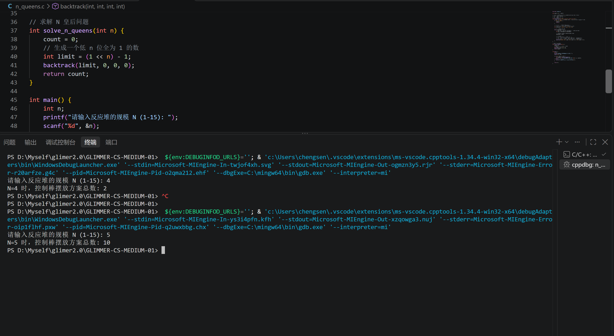
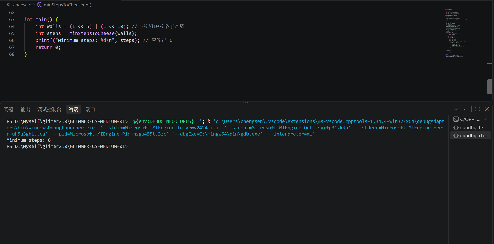

# 模块一：启动引导区 —— 语言的本源
## 任务1
* Q1：请写出十进制 211 对应的二进制表示。
* A1：十进制 **211** 对应的二进制表示为 

**11010011** 

    采用“除2取余，逆序排列”的方法：
    - 211 ÷ 2 = 105 ... 余 1
    - 105 ÷ 2 = 52  ... 余 1
    - 52  ÷ 2 = 26  ... 余 0
    - 26  ÷ 2 = 13  ... 余 0
    - 13  ÷ 2 = 6   ... 余 1
    - 6   ÷ 2 = 3   ... 余 0
    - 3   ÷ 2 = 1   ... 余 1
    - 1   ÷ 2 = 0   ... 余 1
    将余数从下往上逆序排列，得到：11010011

    验证：128 + 64 + 0 + 16 + 0 + 0 + 2 + 1 = 211，结果正确。
* Q2：请写出二进制 10110110 对应的十进制表示。
* A2：**10110110** 对应的十进制表示为
 
**182**

    1×2^7 + 0×2^6 + 1×2^5 + 1×2^4 + 0×2^3 + 1×2^2 + 1×2^1 + 0×2^0
    = 128 + 0 + 32 + 16 + 0 + 4 + 2 + 0
    = 182

* Q3：在 C/C++ 中，如何快速判断一个十进制整数是奇数还是偶数？
* A3：本来想用除以2取余的方式，但介于对本题标题的敏感，我大抵是找到了想要的答案：使用位运算符 **按位与 `&`** 来快速判断。  
    - **方法**：将该整数与 1 进行按位与运算（`n & 1`）。  
    - **原理**：在二进制中，最低位为 1 的数一定是奇数，最低位为 0 的数一定是偶数。`& 1` 操作会屏蔽其他所有高位，只保留最低位，因此效率极高。

    **示例代码：**
    ```c
    int n = 7;
    if (n & 1) {
        printf("奇数\n");
    } else {
        printf("偶数\n");
    }
    ```
# 模块二：能量阵列 —— 逻辑门的重构
## 任务2
* Q1：阅读并推导以下 C/C++ 代码的输出结果，并简要解释你的计算结果。
* A1：预测结果为 **8 29 21 60**  
    **运算过程**
    * res1 = a & b (按位与)：00001100 & 00011001 = 00001000 = 8

    * res2 = a | b (按位或)：00001100 | 00011001 = 00011101 = 29

    * res3 = a ^ b (按位异或)：00001100 ^ 00011001 = 00010101 = 21

    * res4 = (a << 2) | (b >> 1)：

        - a << 2 = 00110000
        - b >> 1 = 00001100
        - res4 = 00110000 | 00001100 = 00111100 = 60

* Q2：给定一个整数x（十进制），同时指定一个位数n，确定这个整数x的二进制表示上第n位是0还是1。例如：251的二进制表示是11111011，n=3，结果返回0。
* A2：  
```c
# include <stdio.h>
int get_bit(int x,int n ){
    
    return (x>>(n - 1)) & 1;
}

int main(void){
    int x = 251;
    int n = 3;
    int result = get_bit(x,n);

    printf("整数 %d 的二进制第 %d 位是：%d\n", x, n,result);

    return 0;
}
```

* Q3：给定一个整数x（十进制），指定一个位数n，给定一个修正值t（0或者1），将整数x的二进制表示上的第n位改为修正值t。输出被修改后的整数。
* A3：  
```c
# include <stdio.h>
int set_bit(int x,int n, int t){
    x = x &~ (1 << (n - 1));
    x = x |(t<<(n - 1));
    return x;
}
int main(void){
    int x = 251;    // 二进制: 11111011
    int n = 3;
    int t = 1;

    int result = set_bit(x, n, t);
    printf("把 %d 的第 %d 位修改为 %d 后，结果是: %d\n", x, n, t, result);
    return 0;
}
```

* Q4：给定一个有符号32位整数x，找到其二进制表示上从右开始的第一个1，并输出该数，例如：x=10,二进制表示为1010,第一个1在第二位，所以输出二进制表示为10的数2。
* A4：
```c
#include <stdio.h>

int first_one(int x) {
    // 利用补码特性
    return x & -x;
}

int main() {
    int x = 10; // 二进制: 1010
    
    int result = first_one(x);
    printf("整数 %d 从右往左第一个1对应的数是: %d\n", x, result);
    
    return 0;
}
```

* Q5：现在有两串无符号数a和b的二进制编码，并且有a < b，每个数字的大小在100位以内，现在问区间[a,b]内&的结果。
* A5:
```c
#include <stdio.h>
#include <string.h>

void range_and(const char *a, const char *b, char *res) {
    int len = strlen(a);
    int diff_pos = -1;

    // 找到从左往右第一个不同的位
    for (int i = 0; i < len; i++) {
        if (a[i] != b[i]) {
            diff_pos = i;
            break;
        }
    }

    // 如果完全相同，结果就是a本身
    if (diff_pos == -1) {
        strcpy(res, a);
        return;
    }

    // 公共前缀保持不变
    for (int i = 0; i < diff_pos; i++) {
        res[i] = a[i];
    }
    // 第一个不同的位及其后面全部置为0
    for (int i = diff_pos; i < len; i++) {
        res[i] = '0';
    }
    res[len] = '\0'; // 字符串结束符
}

int main() {
    char a[] = "11001010";
    char b[] = "11001101";
    char res[100] = {0};
    
    range_and(a, b, res);
    printf("区间 [%s, %s] 内按位与的结果是: %s\n", a, b, res);
    
    return 0;
}
```
## 任务2思考题
* Q1：辑运算和位运算的区别和联系
* A1：

**区别：**
1. **运算对象不同**：
   - 逻辑运算（`&&`、`||`、`!`）的操作数是**整个变量**，把非0值视为“真”，0视为“假”。
   - 位运算（`&`、`|`、`^`、`~`、`<<`、`>>`）的操作数是**整数的二进制位**，逐位进行运算。
2. **结果类型不同**：
   - 逻辑运算的结果只能是 `0`（假）或 `1`（真）。
   - 位运算的结果是一个具体的**整数数值**。
3. **执行特性不同**：
   - 逻辑运算具有**短路求值**特性（例如 `A && B`，若 A 为假，B 就不会被执行）。
   - 位运算没有短路特性，所有操作数都会被完整求值并参与运算。  

**联系：**
1. **底层逻辑一致**：两者都基于布尔代数（0 和 1 的逻辑关系）。
2. **判定规则相通**：在 C 语言中，位运算可以配合 `if` 语句用来做逻辑判断（例如 `if (x & 1)` 用来判断奇偶）。在某些特定场景下（如状态标志位管理），位运算可以代替逻辑运算实现更高效的多条件判断。

* Q3：为什么右移有算数右移和逻辑右移的区别
* A3：
**逻辑右移（对应无符号数）**：
   无符号数的所有位都用来表示数值大小，没有符号位。因此，右移时最高位直接补 `0` 即可，这就是逻辑右移。

**算数右移（对应有符号数）**：
   有符号数的最高位是**符号位**（0表示正数，1表示负数）。如果右移时最高位补 `0`，那么原本最高位为 `1` 的负数，会瞬间变成一个巨大的正数。因此，算数右移要求**最高位补符号位**。如果原来是正数（符号位0），就补0；如果原来是负数（符号位1），就补1。

**总结**：
    逻辑右移是纯粹进行二进制位移动，而算数右移是为了保证有符号数的数学运算正确性而设计的。

# 模块三：通信模块 —— 无碰撞协议
## 任务3
* Q：给定两个仅由小写英文字母组成的字符串 s1 和 s2，请利用位运算，判断它们是否含有公共字符。要求空间复杂度严格为O(1)，时间复杂度为 O(N)。
* A：
```c
#include <stdio.h>

int hasCommonChar(const char *s1, const char *s2) {
    int mask1 = 0;
    int mask2 = 0;

    // 将s1出现的字母映射到 mask1 的对应的位置上
    for (int i = 0; s1[i] != '\0'; i++) {
        // 底层中字符本身也是整数（ASCII码表）s1[i] - 'a' 将字母 a-z 转换为 0-25
        // 1 << (s1[i] - 'a') 将第 (s1[i] - 'a') 位置为 1
        mask1 |= (1 << (s1[i] - 'a'));
    }

    // 将s2出现的字母映射到 mask2 的对应位置上
    for (int i = 0; s2[i] != '\0'; i++) {
        mask2 |= (1 << (s2[i] - 'a'));
    }

    // 将两个掩码进行按位与
    return (mask1 & mask2) != 0;
}

int main() {
    char s1[100];
    char s2[100];

    printf("请输入两个字符串，用空格隔开");
    scanf ("%s %s",s1 ,s2 );

    printf(" 输出: %d\n",hasCommonChar(s1, s2));

    return 0;
}
```
# 模块四：反应堆核心 —— 绝对平衡的艺术
## 任务4
```c
#include <stdio.h>

int count = 0; // 最终解

// limit: 用来限制只保留 N 位（比如 N=4，limit 就是 1111）
// col: 标记哪些列已经被占用
// ld: 标记左斜线被占用
// rd: 标记右斜线被占用
void backtrack(int limit, int col, int ld, int rd) {
    // 如果 col 的每一位都变成了 1（等于 limit），说明 N 个皇后都放好了
    if (col == limit) {
        count++;
        return;
    }

    // 找出当前行所有可以放置皇后的空位
    // (~(col | ld | rd)) 表示所有没有被攻击的位
    int available = limit & ~(col | ld | rd);

    // 找出所有可以放的位置
    while (available != 0) {
        // 提取出最低位的 1（也就是最右边第一个可用的位置）
        int pos = available & -available;
        
        // 把刚刚选中的这个位置从可用列表中剔除
        available ^= pos; 

        // 递归到下一行
        // col | pos：把当前位置列为已占用
        // (ld | pos) << 1：左斜线的攻击范围在下一行要向左偏移1位
        // (rd | pos) >> 1：右斜线的攻击范围在下一行要向右偏移1位
        backtrack(limit, col | pos, (ld | pos) << 1, (rd | pos) >> 1);
    }
}

// 求解 N 皇后问题
int solve_n_queens(int n) {
    count = 0;
    // 生成一个低 n 位全为 1 的数
    int limit = (1 << n) - 1; 
    backtrack(limit, 0, 0, 0);
    return count;
}

int main() {
    int n;
    printf("请输入反应堆的规模 N (1-15): ");
    scanf("%d", &n);

    if (n >= 1 && n <= 15) {
        int result = solve_n_queens(n);
        printf("N=%d 时，控制棒摆放方案总数: %d\n", n, result);
    } else {
        printf("N 的范围必须在 1 到 15 之间！\n");
    }

    return 0;
}
```

**运行截图**


# 模块五：管道穿梭 —— 自动化寻路
## 任务5
```c
#include <stdio.h>
#include <stdbool.h>

// 定义简单队列结构用于 BFS
typedef struct {
    int pos;   // 当前节点编号 (0~15)
    int dist;  // 到达当前节点的最短步数
} Node;

int minStepsToCheese(int walls) {
    int start = 0;
    int target = 15;

    // 如果起点或终点本身是墙，直接不可达
    if ((walls & (1 << start)) || (walls & (1 << target))) {
        return -1;
    }

    // BFS 队列与访问位图
    Node queue[16];
    int front = 0, rear = 0;
    int visited = 0;

    // 起点入队并标记已访问 (请使用位运算)
    queue[rear++] = (Node){start, 0};
    visited |= (1 << start);

    // 上、下、左、右四个方向的节点偏移量
    int dr[4] = {-1, 1, 0, 0};
    int dc[4] = {0, 0, -1, 1};

    //TO DO
    while (front < rear) {
        Node curr = queue[front++];
        if (curr.pos == target) {
            return curr.dist;
        }

        int r = curr.pos / 4;
        int c = curr.pos % 4;

        for (int i = 0; i < 4; i++) {
            int nr = r + dr[i];
            int nc = c + dc[i];

            if (nr >= 0 && nr < 4 && nc >= 0 && nc < 4) {
                int npos = nr * 4 + nc;

                if ((walls & (1 << npos)) == 0 && (visited & (1 << npos)) == 0) {
                    visited |= (1 << npos);
                    queue[rear].pos = npos;
                    queue[rear].dist = curr.dist + 1;
                    rear++;
                }
            }
        }
    }
    //END OF TO DO

    return -1; // 无法到达
}

int main() {
    int walls = (1 << 5) | (1 << 10); // 5号和10号格子是墙
    int steps = minStepsToCheese(walls);
    printf("Minimum steps: %d\n", steps); // 应输出 6
    return 0;
}
```

**运行截图**


# 后记
## 工程师个人日志
### 新生
* 星历 3024 年 7 月 21 日 19 时 56 分       

敲下最后一个字符，我靠在驾驶舱的椅背上，长长地呼出了一口气。在这片寂静到能听见宇宙微波背景辐射的深空里，我，巍然矗立。瞻望，群星闪着黯淡微光，或许，我的前途依然如这无尽长夜，不见希望，但好像也不是那样的悲怆。可能前方等待我的将不只是恒星，而是引力坍缩的黑洞、从未被标注的星系，甚至是“歌者”的降维打击……  

然而，航向已锁定。  

“从没有真正的绝望，只有被思想困住的囚徒”  

愿此行，终抵微光。